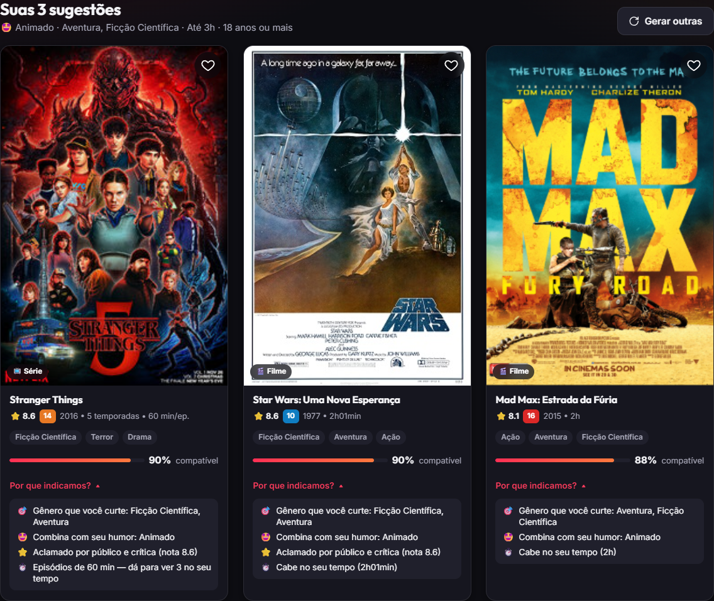
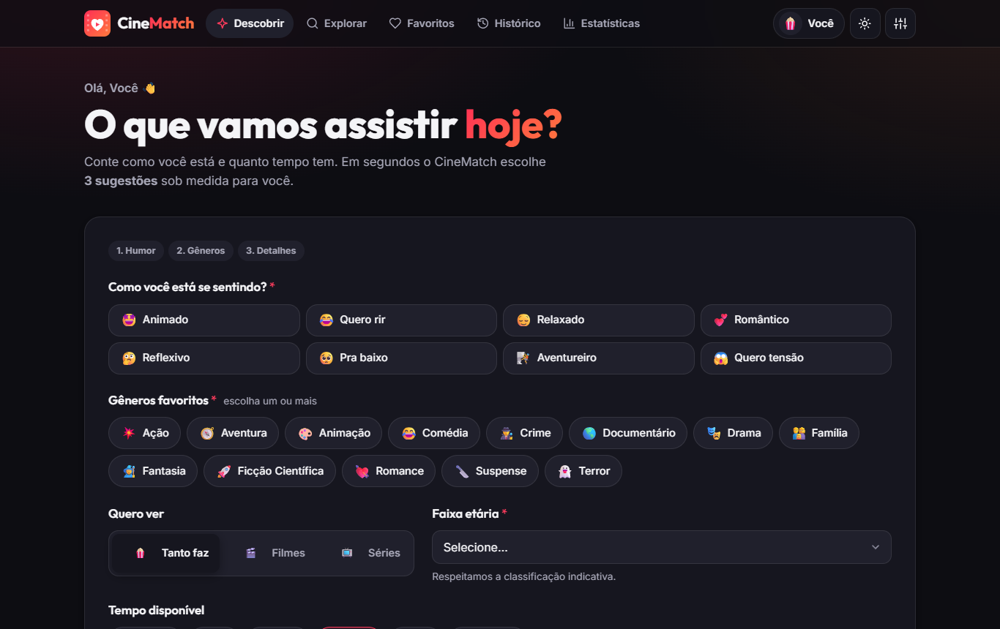
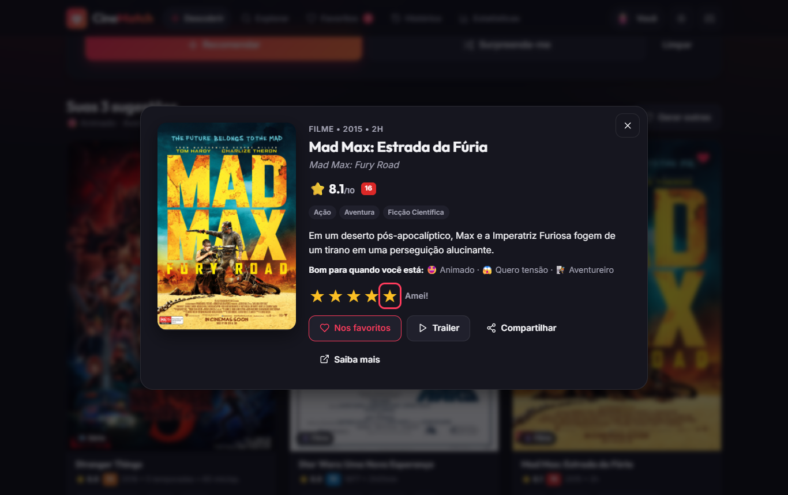
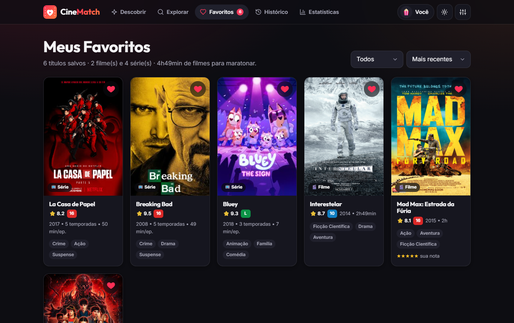
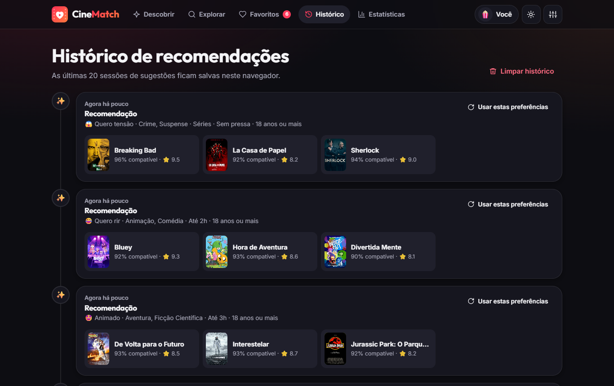
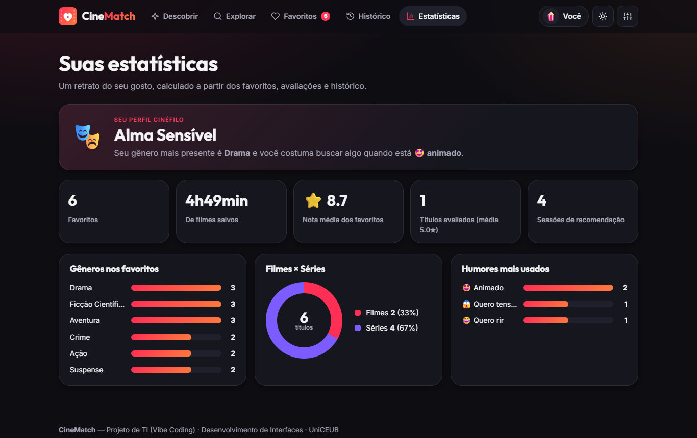
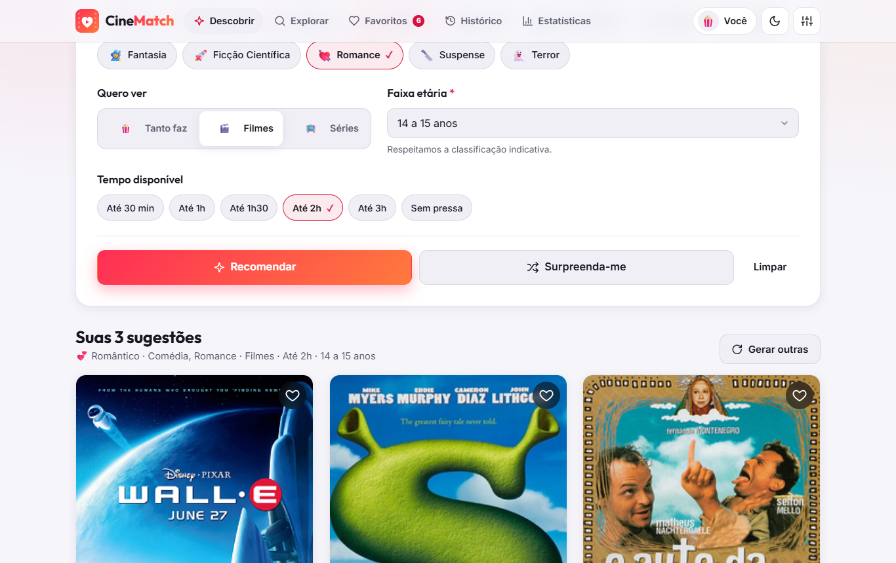
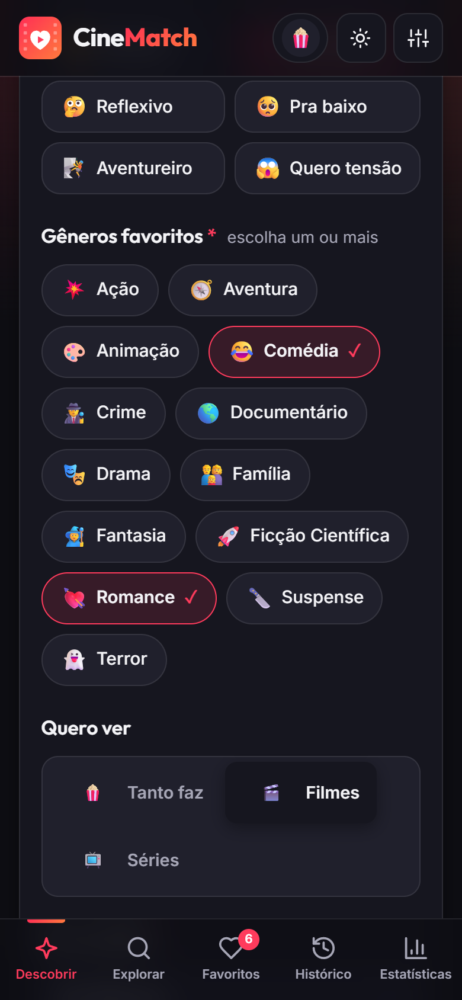
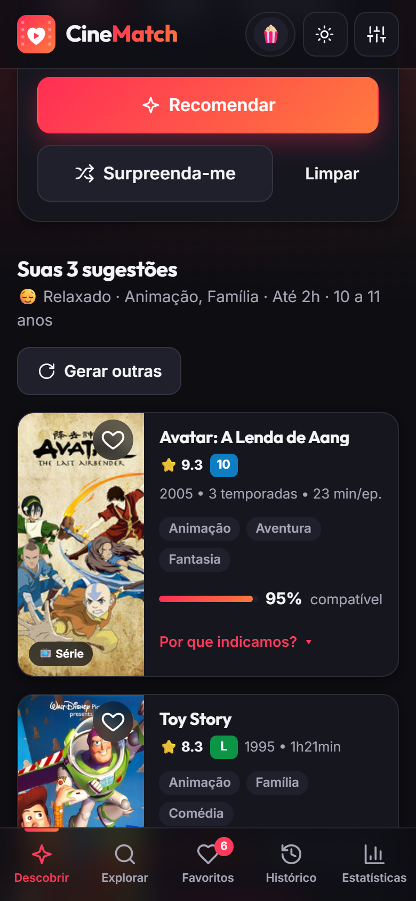

<div align="center">
  

  # CineMatch 🎬
  **Recomendador de Filmes e Séries** — diga como você está e quanto tempo tem; o CineMatch escolhe 3 sugestões sob medida.

  ### 🔗 [Acessar a aplicação online](https://pedrobarcelos10.github.io/cinematch/)

  `https://pedrobarcelos10.github.io/cinematch/`

  
  
  
  
  
</div>

---



## 📌 Sobre o projeto

Projeto de TI (Vibe Coding) da disciplina **Desenvolvimento de Interfaces (HTML, CSS e JavaScript)** — UniCEUB.

Muitas pessoas passam mais tempo procurando algo para assistir do que realmente assistindo. O **CineMatch** reduz essa indecisão: o usuário informa humor, gêneros favoritos, faixa etária e tempo disponível, e recebe três recomendações com **% de compatibilidade** e a explicação de **por que** cada título foi indicado.

Todo o desenvolvimento foi conduzido com **Vibe Coding** (programação assistida por IA). Os prompts utilizados estão documentados em [`docs/PROMPTS.md`](docs/PROMPTS.md).

## ✅ Requisitos funcionais

| Requisito | Status | Onde |
|---|---|---|
| RF01 – Selecionar preferências (gênero, faixa etária, tempo, humor) | ✅ | Aba **Descobrir** |
| RF02 – Gerar recomendações (3 sugestões) | ✅ | `js/recommender.js` |
| RF03 – Adicionar favoritos | ✅ | Coração em cada card |
| RF04 – Remover favoritos (com “Desfazer”) | ✅ | Aba **Favoritos** |
| RF05 – Visualizar histórico | ✅ | Aba **Histórico** |
| RF06 – Salvar dados localmente | ✅ | `js/storage.js` (LocalStorage) |
| Tema claro e escuro | ✅ | Botão ☀️/🌙 no topo (atalho `T`) |

## ✨ Diferenciais

- 🌐 **Consumo de APIs externas** sem chave: pôsteres e busca de filmes pela **Wikipédia** e de séries pela **TVMaze**, com cache de 7 dias e tolerância a falhas.
- 🧠 **Recomendação explicável e que aprende**: pontuação ponderada (gêneros 40%, humor 30%, nota 15%, suas avaliações 10%, tempo 5%) e motivos legíveis em cada sugestão.
- ⭐ **Avaliação por estrelas** (acessível por teclado) que influencia as próximas recomendações.
- 🔎 **Busca** instantânea no catálogo (ignora acentos) + busca na internet.
- 📊 **Estatísticas**: indicadores, gráfico de gêneros, rosca filmes × séries, humores mais usados e “perfil cinéfilo”.
- 👥 **Perfis de usuário**: cada pessoa com favoritos, histórico, avaliações e preferências próprios.
- 🎲 **Surpreenda-me** com animação de roleta.
- 🛡️ **Classificação indicativa brasileira** sempre respeitada (selos nas cores oficiais).
- 📱 **PWA instalável** que funciona offline (service worker).
- 💾 **Backup**: exportar/importar dados em JSON.
- ⌨️ **Atalhos de teclado**: `1`–`5` abas, `/` busca, `T` tema, `?` ajuda.
- ♿ **Acessibilidade**: HTML semântico, `aria-live`, foco visível, *skip link*, `prefers-reduced-motion`, contraste AA.

## 🖼️ Capturas de tela

| Tela inicial | Detalhes e avaliação |
|---|---|
|  |  |
| **Favoritos** | **Histórico** |
|  |  |
| **Estatísticas** | **Tema claro** |
|  |  |

<p align="center">
  
  
</p>

## 🗂️ Estrutura do projeto

```
cinematch/
├── index.html              # Estrutura semântica (SPA com 5 telas e diálogos)
├── manifest.webmanifest    # Configuração do PWA
├── sw.js                   # Service worker (funciona offline)
├── css/
│   └── style.css           # Design tokens, temas, componentes e responsividade
├── js/
│   ├── movies.js           # Catálogo (75 títulos) e constantes de domínio
│   ├── storage.js          # Camada de LocalStorage (perfis, favoritos, histórico…)
│   ├── api.js              # Integração com Wikipédia e TVMaze
│   ├── recommender.js      # Motor de recomendação explicável
│   ├── ui.js               # Componentes de interface (cards, toasts, diálogos)
│   └── app.js              # Controlador: eventos, rotas e telas
├── assets/
│   └── images/             # Logo, favicon e ícones do PWA
└── docs/
    ├── PROMPTS.md          # Registro dos prompts (Vibe Coding)
    └── screenshots/        # Capturas usadas no relatório
```

## ▶️ Como executar localmente

Não há dependências nem etapa de build.

1. Clone o repositório:
   ```bash
   git clone https://github.com/pedrobarcelos10/cinematch.git
   cd cinematch
   ```
2. Abra o `index.html` no navegador **ou**, para testar também o modo offline (PWA), sirva a pasta:
   ```bash
   python -m http.server 5500
   ```
   e acesse `http://localhost:5500`.

## 🧰 Tecnologias

- **HTML5** semântico e acessível (`<dialog>`, `fieldset`/`legend`, ARIA)
- **CSS3** puro: variáveis, Grid, Flexbox, `clamp()`, `conic-gradient`, animações
- **JavaScript** (ES2020+, sem frameworks): DOM, eventos, `fetch`/`async-await`, `AbortController`
- **LocalStorage** para persistência
- **APIs**: [MediaWiki (Wikipédia)](https://www.mediawiki.org/wiki/API:Main_page) e [TVMaze](https://www.tvmaze.com/api)
- **IA (Vibe Coding)**: Claude (Anthropic), via Claude Code

## 📚 Créditos

- Pôsteres e resumos: [Wikipédia](https://www.wikipedia.org) (CC BY-SA) e [TVMaze](https://www.tvmaze.com) (CC BY-SA).
- Notas e durações aproximadas, usadas apenas para fins educacionais.

---

Desenvolvido por **Pedro Vinicius De Paula Barcelos** · UniCEUB · 2026
